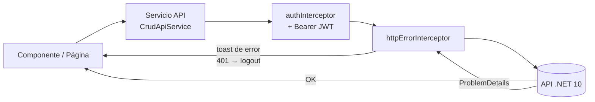
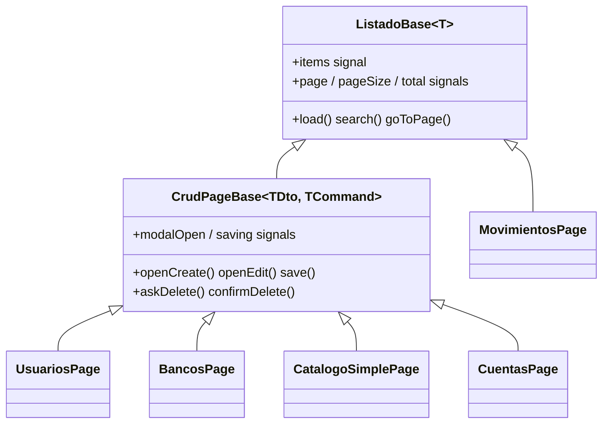

# 💶 Gestión de Gastos — Angular 20 + Tailwind CSS 4

SPA financiera para la gestión de gastos e ingresos familiares, construida con **Angular 20** y conectada a una API REST en **.NET 10**. Es un proyecto de referencia para aplicar las prácticas modernas del framework: **Signals, standalone components, control de flujo nativo, `inject()`, interceptores y guards funcionales**.


---

## 📌 Resumen para reclutadores

| | |
|---|---|
| **Qué es** | SPA con login JWT, roles (administrador / usuario), CRUD paginados y registro de movimientos bancarios. |
| **Frontend** | Angular 20.3 · TypeScript 5.8 (`strict`) · RxJS 7.8 · Tailwind CSS 4.3 · ngx-toastr 19 |
| **Backend consumido** | API .NET 10 (CQRS, DDD, JWT, `ProblemDetails`) documentada con OpenAPI 3.1 |
| **Arquitectura** | Por capas y por características: `core` / `shared` / `features`, con *lazy loading* por ruta |
| **Estado** | Angular **Signals** (`signal`, `computed`, `input`, `output`) |
| **Seguridad** | Interceptor JWT funcional, guards funcionales por rol, control de caducidad del token |
| **Gestión de errores** | Interceptor que traduce `ProblemDetails` / `ValidationProblemDetails` a toasts |

### Cómo verificar el stack en 30 segundos

Todo es comprobable en el propio repositorio:

| Qué verificar | Dónde mirar |
|---|---|
| Versiones de Angular, Tailwind, ngx-toastr, RxJS | [`package.json`](package.json) y `package-lock.json` |
| `strict` + `strictTemplates` de TypeScript/Angular | [`tsconfig.json`](tsconfig.json) |
| Providers globales (router, HTTP, toastr, locale `es-ES`) | [`src/app/app.config.ts`](src/app/app.config.ts) |
| Rutas, *lazy loading* y guards | [`src/app/app.routes.ts`](src/app/app.routes.ts) |
| Interceptores funcionales | [`src/app/core/interceptors/`](src/app/core/interceptors) |
| Guards funcionales | [`src/app/core/guards/auth.guard.ts`](src/app/core/guards/auth.guard.ts) |
| Estado con Signals (sesión) | [`src/app/core/services/auth.service.ts`](src/app/core/services/auth.service.ts) |
| Reutilización (herencia de listados/CRUD) | [`src/app/shared/base/`](src/app/shared/base) |

Comandos de comprobación rápida:

```bash
# No hay inyección por constructor ni directivas estructurales antiguas
grep -rn "constructor(" src          # → sin resultados
grep -rnE "\*ngIf|\*ngFor" src       # → sin resultados
grep -rn "inject(" src | wc -l       # → inyección con la función inject()
npm run build                        # → compila sin errores
```

---

## ✨ Buenas prácticas aplicadas

| Práctica | Aplicación en el proyecto |
|---|---|
| **Standalone components** | Todos los componentes declaran `standalone: true`; no hay `NgModule`. |
| **Signals** | Estado de sesión (`AuthService`), listados, modales, carga y paginación (`signal`, `computed`); entradas/salidas con `input()` / `output()`. |
| **`inject()`** | Inyección de dependencias sin constructores, en servicios, componentes, guards e interceptores. |
| **Control de flujo nativo** | `@if`, `@for` (con `track`) y `@empty` en todas las plantillas. |
| **Interceptores funcionales** | `authInterceptor` (adjunta `Bearer` solo a peticiones de nuestra API) y `httpErrorInterceptor`. |
| **Guards funcionales** | `authGuard`, `adminGuard`, `guestGuard`; el primero conserva `returnUrl` y el login valida que sea una ruta interna (evita *open redirect*). |
| **Lazy loading** | Cada página se carga con `loadComponent` bajo demanda. |
| **Formularios reactivos tipados** | `NonNullableFormBuilder`, validaciones y mensajes reutilizables (`FormFieldComponent`). |
| **DRY y SOLID** | `CrudApiService<TDto, TCommand>` para la capa HTTP y `ListadoBase` / `CrudPageBase` para las páginas: añadir un mantenimiento nuevo son unas pocas líneas. |
| **Separación de responsabilidades** | Acceso a `localStorage` aislado en `TokenStorageService`; decodificación del JWT en una utilidad pura (`jwt.util.ts`); mapeo de errores en `problem-details.util.ts`. |
| **Tailwind CSS 4** | Diseño responsivo y corporativo; clases semánticas reutilizables (`.btn-primary`, `.input`, `.card`…) mediante `@layer components`. |
| **Accesibilidad básica** | `role="dialog"`, `aria-modal`, `aria-label`, cierre con `Esc`, etiquetas asociadas a los campos. |
| **Internacionalización** | Locale `es-ES` registrado; fechas e importes en formato español. |

---

## 🏗️ Arquitectura

```
src/app/
├── core/                      # Transversal a toda la app (singleton)
│   ├── guards/                #   authGuard · adminGuard · guestGuard
│   ├── interceptors/          #   auth.interceptor · http-error.interceptor
│   ├── models/                #   Contratos de la API (DTOs / commands)
│   ├── services/
│   │   ├── api/               #   CrudApiService<T> + un servicio por recurso
│   │   ├── auth.service.ts    #   Sesión basada en Signals
│   │   └── token-storage.service.ts
│   └── utils/                 #   jwt · problem-details · http-params · format
├── shared/                    # Reutilizable y sin lógica de negocio
│   ├── base/                  #   ListadoBase · CrudPageBase
│   ├── components/            #   modal · pagination · form-field · confirm-dialog
│   └── layout/                #   dashboard-layout · sidebar · navbar
└── features/                  # Páginas contenedor, una carpeta por funcionalidad
    ├── auth/login
    ├── usuarios
    ├── configuracion/         #   bancos · catalogo-simple (categorías y tipos de cuenta)
    ├── cuentas
    └── movimientos
```

### Flujo de una petición HTTP



### Jerarquía de las páginas



---

## 🛠️ Tecnologías

| Categoría | Tecnología | Versión (lockfile) |
|---|---|---|
| Framework | Angular (core, router, forms, animations) | 20.3 |
| Lenguaje | TypeScript | 5.8 |
| Reactividad | Signals + RxJS | — / 7.8 |
| Estilos | Tailwind CSS (+ `@tailwindcss/postcss`) | 4.3 |
| Notificaciones | ngx-toastr | 19.1 |
| Build | Angular CLI + `@angular/build` (esbuild) | 20.3 |
| Tipografía | Inter (Google Fonts) | — |

---

## 🚀 Puesta en marcha

**Requisitos**: Node.js 20.19+ (o 22 LTS) y npm.

```bash
git clone <url-del-repositorio>
cd app-gestion-gastos
npm install
npm start            # http://localhost:4200
```

Configura la URL de la API en [`src/environments/environment.ts`](src/environments/environment.ts):

```ts
export const environment = {
  apiUrl: 'https://localhost:44377',
};
```

> La API debe permitir **CORS** desde `http://localhost:4200`.

Scripts disponibles:

| Comando | Descripción |
|---|---|
| `npm start` | Servidor de desarrollo con recarga en caliente |
| `npm run build` | Compilación de producción en `dist/` |

---

## 🔌 Contrato con la API

El cliente está construido a partir del documento OpenAPI de la API (`openapi.json`):

| Recurso | Endpoints en el OpenAPI | Uso en la SPA |
|---|---|---|
| Auth | `POST /api/auth/login` | Login |
| Bancos · Categorías · Tipos de cuenta | `GET`, `POST` | Listado paginado y alta |
| Usuarios | `GET`, `POST` | Listado paginado y alta |
| Movimientos | `GET` (filtros y paginación), `POST` | Listado y registro |

---

## 👤 Autor

**Iván** — Desarrollador Full-Stack (.NET / Angular)

- GitHub: https://github.com/ipeinadocoiradas
- LinkedIn: https://www.linkedin.com/in/ivanpeinadocoiradas/


